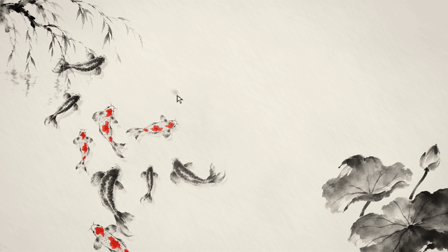

<div align="center">

# 묵연 · Mukyeon

**윈도우 바탕화면 아이콘 뒤에서 사는 수묵 잉어 연못.**<br>
한지 위에서 잉어 아홉 마리가 헤엄치고, 물결이 그림을 일렁이게 하고, 물고기가 마우스를 따라옵니다.

[English](README.md) · [다운로드](https://github.com/binibinibin123/mukyeon/releases/latest) · [30초 시연 영상 (mp4)](docs/demo.mp4)

<a href="docs/demo.mp4"></a>

</div>

---

## 무엇인가

묵연(墨緣)은 Godot 4와 작은 C++ 도우미로 만든 윈도우용 라이브 월페이퍼입니다. 영상을 반복 재생하는 게 아니라,
연못을 매 프레임 계산합니다.

- **마우스를 알아채는 물고기.** 마우스를 움직이면 잉어들이 제각기 알아채는 속도로 하나씩 방향을 틉니다.
  물고기마다 머무는 거리와 도는 방향이 다릅니다. 마우스를 휙 휘두르면 놀라서 달아납니다.
- **먹과 물.** 마우스와 꼬리가 먹을 한지에 번지게 하고, 물결 시뮬레이션이 그림 전체를 일렁이게 합니다.
- **그린 그림.** 잉어, 버드나무, 연꽃은 붓으로 그린 그림입니다. 잉어는 척추를 따라 휘어지는 띠로 그려서
  방향을 틀 때 스티커처럼 미끄러지지 않고 몸이 휘어집니다.
- **아이콘 뒤에서.** 창이 바탕화면 레이어에 들어가 있어서 아이콘은 그대로 클릭됩니다.
- **조용히.** 전체화면 앱이 가리면 멈추고, 평소엔 30fps로 쉬며, 끝내면 원래 배경화면을 되돌려 놓습니다.

## 설치

1. [최신 릴리스](https://github.com/binibinibin123/mukyeon/releases/latest)에서 `Mukyeon-<버전>-windows.zip`을 받아 아무 폴더에 풉니다.
2. `Mukyeon.exe`를 실행합니다. `mukyeon_helper.exe`는 같은 폴더에 두세요.
3. 끝내려면 작업 표시줄 트레이의 잉어 아이콘을 우클릭해서 **Quit**을 누릅니다. 원래 배경화면이 돌아옵니다.

윈도우 시작 시 자동 실행: `Win + R`로 `shell:startup`을 열고 `Mukyeon.exe` 바로가기를 넣으세요.

실행 파일은 코드 서명이 없어서 SmartScreen 경고가 뜰 수 있습니다. 내려받은 파일이 미덥지 않으면 아래처럼 직접 빌드하세요.

## 소스에서 실행

[Godot 4.7.2](https://godotengine.org/download/archive/4.7.2-stable/)와 MinGW-w64 `g++`가 필요합니다.

```bash
g++ -std=c++17 -O2 -municode -mwindows -static helper/helper.cpp -o helper/mukyeon_helper.exe -lws2_32 -lshell32 -luser32
Godot_v4.7.2-stable_win64.exe --path . -- --windowed   # 일반 창으로 먼저 확인
Godot_v4.7.2-stable_win64.exe --path .                  # 바탕화면에 붙여서 실행
```

`tools/package.sh 버전`이 윈도우 빌드를 내보내고 도우미와 함께 zip으로 묶습니다.

## 구조

자세한 설명은 [docs/ARCHITECTURE.md](docs/ARCHITECTURE.md)에 있습니다(영문).

## 성능

RTX 3060, 1920×1080, 윈도우 11에서 GPU 약 3%, CPU 코어 하나의 약 1%를 씁니다. 평소 30fps이고, 마우스를 움직인 뒤
2초 동안만 60fps로 올라갑니다.

## 한계와 계획

- 지금은 주 모니터 한 대만 지원합니다. 윈도우 11 23H2에서 만들고 확인했고, 윈도우 10은 아직 확인하지 못했습니다.
- 앞으로: 다중 모니터, 시간대별 풍경, 날씨, 물소리, 설정 창, 트레이의 자동 실행 토글.

## 그림

그림 네 점(잉어 둘, 버드나무, 연꽃)은 [CC0](art/LICENSE)로 공개합니다. 마음껏 쓰세요.
프롬프트는 [`art/prompts`](art/prompts), 정리 스크립트는 [`art/prep.py`](art/prep.py)에 있습니다.

## 라이선스

코드 [MIT](LICENSE), 그림 [CC0 1.0](art/LICENSE).
