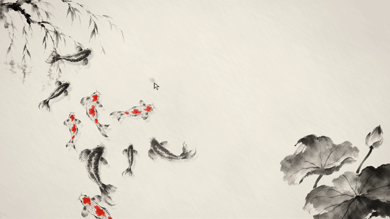

<div align="center">

# 묵연 · Mukyeon

**An ink-wash koi pond that lives behind your Windows desktop icons.**<br>
Nine carp swim on hanji paper, ripples bend the painting, and the fish follow your cursor.

[](https://github.com/binibinibin123/mukyeon/actions/workflows/ci.yml)
[](LICENSE)
[](art/LICENSE)


[한국어](README.ko.md) · [Download](https://github.com/binibinibin123/mukyeon/releases/latest) · [Full 30 s demo (mp4)](docs/demo.mp4)

<a href="docs/demo.mp4"></a>

</div>

---

## What it is

Mukyeon (묵연, "ink bond") is a live wallpaper for Windows built with Godot 4 and a small C++ helper.
It is not a video loop. The pond is simulated every frame:

- **Fish that notice you.** Move the mouse and the carp turn towards it one by one, each at its own pace.
  Each fish keeps its own distance and circles the cursor its own way. Flick the mouse at them and they dart off.
- **Ink and water.** The cursor and the fish tails stir ink into the paper. A ripple simulation bends the whole
  painting, so the willow reflections wobble and the carp shimmer when something passes.
- **Painted, not rendered.** The carp, willow and lotus are brush paintings. The carp are drawn as bendable strips
  that follow a spine, with soft shadows, so they curve when they turn instead of sliding like stickers.
- **Behind the icons.** The window sits in the desktop layer under your icons. They stay clickable.
- **Polite.** It pauses while a full-screen app covers the desktop, idles at 30 fps, and puts your normal wallpaper
  back when you quit.

## Install

1. Download `Mukyeon-<version>-windows.zip` from the [latest release](https://github.com/binibinibin123/mukyeon/releases/latest)
   and unzip it anywhere.
2. Run `Mukyeon.exe`. Keep `mukyeon_helper.exe` next to it.
3. To quit, right-click the carp icon in the system tray and choose **Quit**. Your old wallpaper comes back.

To start it with Windows, press `Win + R`, run `shell:startup`, and drop a shortcut to `Mukyeon.exe` there.

The binaries are not code-signed, so Windows SmartScreen may ask you to confirm. If you would rather not run a
download, build it yourself (below) — it is two commands.

## Run from source

You need [Godot 4.7.2](https://godotengine.org/download/archive/4.7.2-stable/) and a MinGW-w64 `g++`.

```bash
# 1. the helper that moves the window behind the icons and watches for full-screen apps
g++ -std=c++17 -O2 -municode -mwindows -static helper/helper.cpp -o helper/mukyeon_helper.exe -lws2_32 -lshell32 -luser32

# 2a. try it in a normal window first
Godot_v4.7.2-stable_win64.exe --path . -- --windowed

# 2b. or attach it to the desktop for real
Godot_v4.7.2-stable_win64.exe --path .
```

`tools/package.sh VERSION` exports the Windows build and zips it with the helper.

## How it works

| Piece | What it does |
| --- | --- |
| `shaders/paper_bake.gdshader` | Draws the hanji paper once: fibres, grain, vignette. |
| `shaders/sim.gdshader` | One step of the pond on a 480×270 texture, ping-ponged between two viewports. Red is ink, green is water height, blue is water velocity. |
| `shaders/paper_view.gdshader` | Soaks the ink into the paper, catching on the fibres. |
| `fish_school.gd` | Fish steering: wander, keep apart, stay off the edges, follow the cursor. Draws each carp as a strip along a 14-joint spine. |
| `shaders/water.gdshader` | Last pass. Reads the water height and bends and shades everything drawn so far. |
| `helper/helper.cpp` | Parents the Godot window into the desktop layer (`WorkerW`), reports full-screen apps over UDP, repaints the wallpaper on exit. |

A longer write-up with the tricks that were not obvious is in [docs/ARCHITECTURE.md](docs/ARCHITECTURE.md).

## Performance

Measured on a Windows 11 PC with an RTX 3060 at 1920×1080: about 3 % GPU and about 1 % of one CPU core.
The frame rate is capped at 30 fps and rises to 60 fps for two seconds after the mouse moves, so ripples
stay smooth without burning power while you read. `godot.log` prints frame-time stats every 10 seconds.

## Limits

- Primary monitor only, for now.
- Built and tested on Windows 11 23H2. Windows 10 uses the same desktop-layer trick but has not been tested.
- Requires OpenGL 3.3 (the Godot Compatibility renderer).
- No settings window yet; the knobs are constants at the top of `main.gd` and `fish_school.gd`.

## Roadmap

- [ ] Multi-monitor
- [ ] Time of day: dawn mist, dusk, night with a moon
- [ ] Rain and wind that follow real weather
- [ ] Soft water sounds
- [ ] A small settings window (fish count, frame rate, ink colour)
- [ ] Start-with-Windows toggle in the tray menu

## Art and AI disclosure

The four paintings (two carp, a willow branch, a lotus) were generated with an AI image model from the prompts in
[`art/prompts`](art/prompts), then cleaned up with [`art/prep.py`](art/prep.py). They are released as
[CC0](art/LICENSE), so use them freely. The code was written with an AI coding assistant (Claude).

## Contributing

Bug reports, ideas and pull requests are welcome. Read [CONTRIBUTING.md](CONTRIBUTING.md) first; it is short.

## License

Code: [MIT](LICENSE). Art: [CC0 1.0](art/LICENSE).
